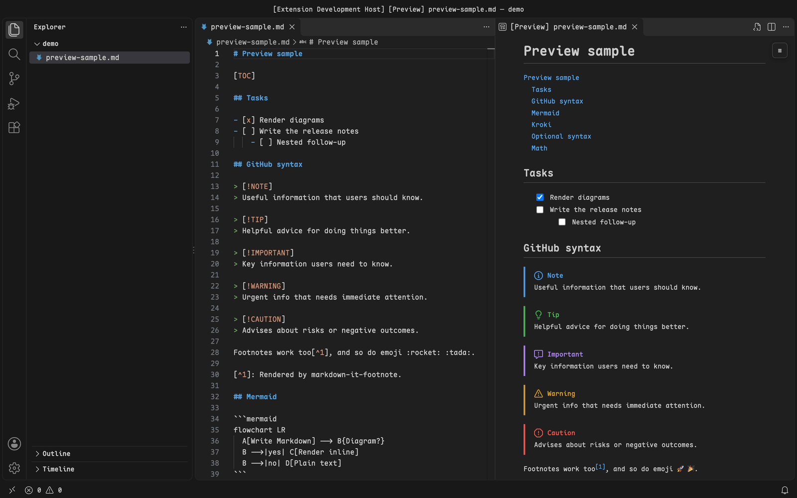
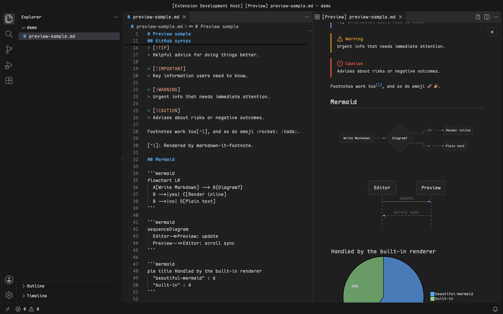
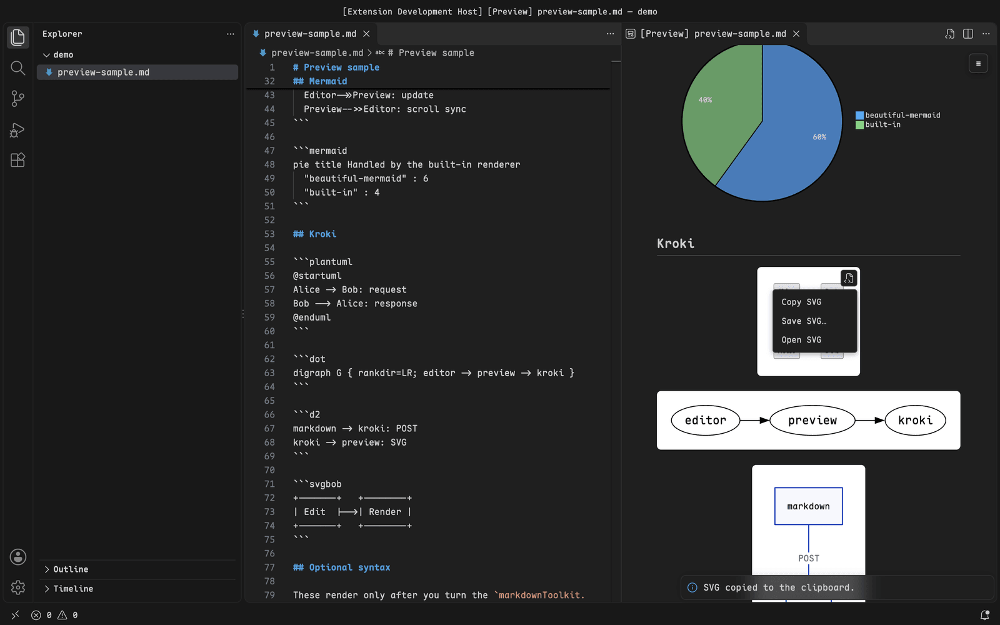
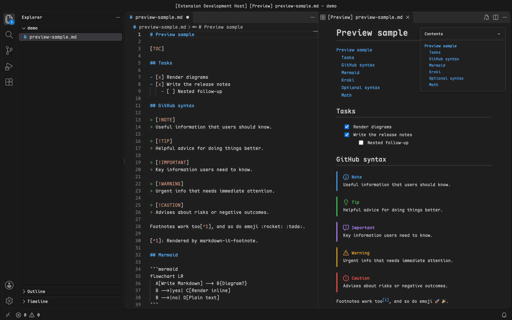
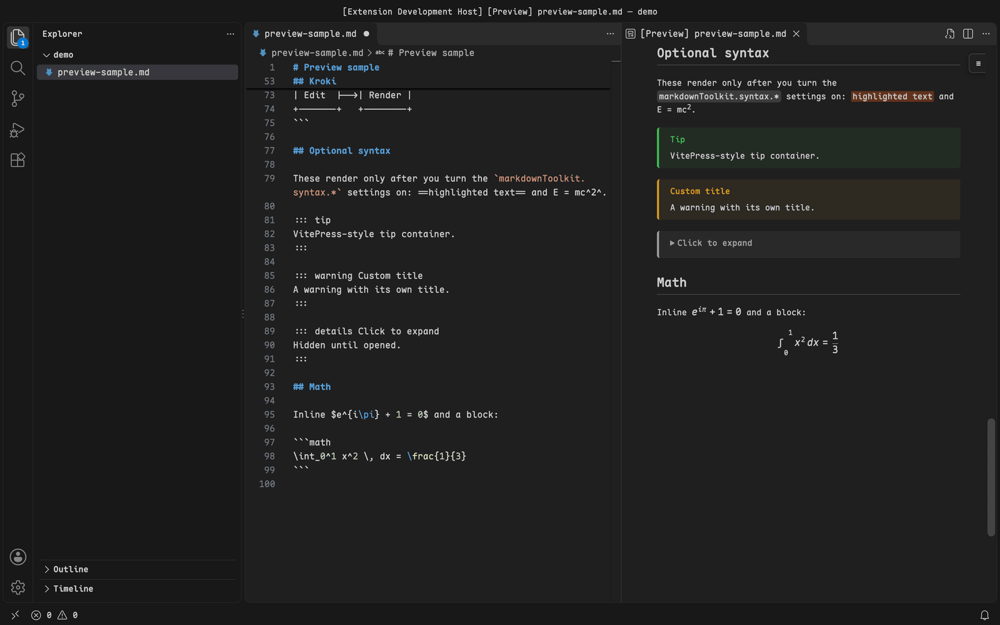

# Markdown Preview Toolkit

**English** · [简体中文](./zh/README.md)

See diagrams, tables of contents and GitHub-style Markdown rendered right in VS Code's built-in Markdown preview, without switching to a separate preview extension.

[](https://marketplace.visualstudio.com/items?itemName=HeavenSky.markdown-preview-toolkit)
[](https://marketplace.visualstudio.com/items?itemName=HeavenSky.markdown-preview-toolkit)
[](./LICENSE.txt)



## Get started

1. Install from the [VS Code Marketplace](https://marketplace.visualstudio.com/items?itemName=HeavenSky.markdown-preview-toolkit). VS Code 1.101 or later is required.
2. Open a Markdown file and run **Markdown: Open Preview to the Side**.
3. The preview renders the blocks described below; everything else looks exactly as before.

## Render Mermaid with beautiful-mermaid

`mermaid` code blocks render as crisp inline SVG with [beautiful-mermaid](https://github.com/lukilabs/beautiful-mermaid): flowcharts, state, sequence, class and ER diagrams, and XY charts. By default diagrams take their colors from your current color theme, so they blend into the preview in light and dark mode alike; you can also pick any of beautiful-mermaid's 15 themes for each mode.

Diagram types beautiful-mermaid does not support, such as `pie`, `gantt` and `mindmap`, fall back to VS Code's built-in Mermaid renderer, so every diagram still shows up. On VS Code versions without the built-in renderer (before 1.121), or when it is disabled, they are rendered through Kroki instead. Turn off `markdownToolkit.mermaid.enabled` to hand all Mermaid blocks back to the built-in renderer.

## Render PlantUML, Graphviz, D2 and more with Kroki

Code blocks in any of [Kroki's diagram languages](https://kroki.io/#support) render as inline SVG on a white card: `plantuml`, `graphviz` or `dot`, `d2`, `bpmn`, `excalidraw`, `nomnoml`, `wavedrom` and more. The preview restyles text with your preview font, and monospaced text with your editor font, while the SVG itself stays exactly as Kroki returned it; diagrams that pin text widths (such as PlantUML) may look slightly squeezed. The first render shows a placeholder; the preview refreshes as soon as the diagram arrives, and results are cached until the source changes.



**By default diagrams are sent to the public server at `https://kroki.io`.** To keep them on your machine, run Kroki locally and point `markdownToolkit.kroki.server` at it:

```bash
docker run -d --name kroki -p 8000:8000 yuzutech/kroki
```

```json
{ "markdownToolkit.kroki.server": "http://localhost:8000" }
```

BPMN, Excalidraw and diagrams.net need Kroki's companion containers (`yuzutech/kroki-bpmn`, `yuzutech/kroki-excalidraw`, `yuzutech/kroki-diagramsnet`); see the [Kroki install guide](https://docs.kroki.io/kroki/setup/use-docker-or-podman/). Use `markdownToolkit.kroki.languages` to map extra language names, and run **Markdown Preview Toolkit: Clear Diagram Cache and Refresh Preview** when the Kroki server starts returning different output, for example after you upgrade or switch servers.

## Copy, save or open any diagram as SVG

Hover a diagram and click the source icon in its top-right corner to copy the SVG source, save it as a `.svg` file, or open it on its own in VS Code's image viewer. You always get the original SVG from beautiful-mermaid or Kroki, not the restyled copy shown in the preview. The first time, VS Code asks whether to let the extension open a `vscode://` link; tick **Do not ask me again for this extension** to skip the prompt.



## Navigate long documents with a table of contents

Write `[TOC]` or `[[toc]]` on a line of its own and the preview replaces it with a linked, nested table of contents. A floating outline also sits in the top-right corner of the preview: it highlights the section you are reading, collapses to a button in narrow previews, and jumps to a heading when you click its entry.

Choose the heading levels with `markdownToolkit.toc.minLevel` and `markdownToolkit.toc.maxLevel` (1 to 3 by default), or turn the floating outline off with `markdownToolkit.toc.sidebar`. The Markdown source is never modified.

## Check off tasks from the preview

List items that start with `[ ]` or `[x]` show up as checkboxes. Click one in the preview and the matching `[ ]` or `[x]` in your Markdown file flips; the file is changed but not saved, so you can undo it like any other edit.

On the first click, VS Code asks whether to let the extension open a `vscode://` link, because the preview uses that link to reach the extension. Tick **Do not ask me again for this extension** to skip the prompt. Turn off `markdownToolkit.taskList.clickToToggle` to keep the checkboxes read-only.



## Write GitHub-flavored Markdown that renders the same as on GitHub

Alerts, footnotes and emoji shortcodes now render as they do on GitHub; the built-in preview shows them as plain text:

- Alerts: `> [!NOTE]`, `> [!TIP]`, `> [!IMPORTANT]`, `> [!WARNING]` and `> [!CAUTION]` become colored callouts with an icon.
- Footnotes: `[^1]` becomes a linked superscript, with the notes collected at the end.
- Emoji shortcodes: `:rocket:` becomes 🚀. Emoticons such as `:)` stay as typed.

Each has its own setting (`markdownToolkit.alerts.enabled`, `markdownToolkit.footnotes.enabled`, `markdownToolkit.emoji.enabled`), and open previews update as soon as you change one.

## Turn on extra syntax when you need it

Three non-GitHub syntax extensions are off by default so your files stay portable. Turn them on in settings when your documents use them:

- `markdownToolkit.syntax.mark`: `==highlighted text==`
- `markdownToolkit.syntax.superscript`: `E = mc^2^`
- `markdownToolkit.syntax.containers`: VitePress-style `::: tip`, `::: info`, `::: warning`, `::: danger` and `::: details`, each with an optional title such as `::: warning Read this first`



## When not to use it

The toolkit extends the built-in preview only. If you need a standalone preview with its own export pipeline, use a dedicated extension such as Markdown Preview Enhanced instead.

## Learn more

Commands and settings are listed on the marketplace page's **Feature Contributions** tab. See the [changelog](./CHANGELOG.md) for what changed in each release.

## License

[MIT](./LICENSE.txt)
