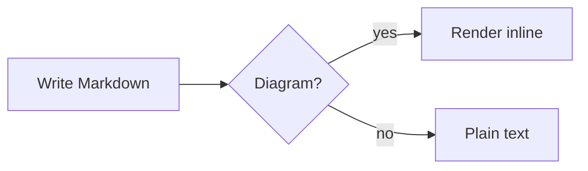
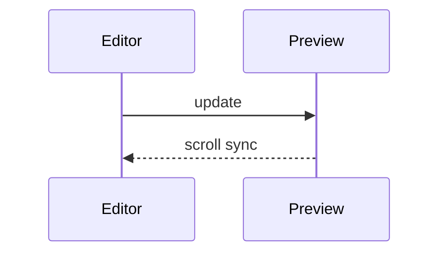
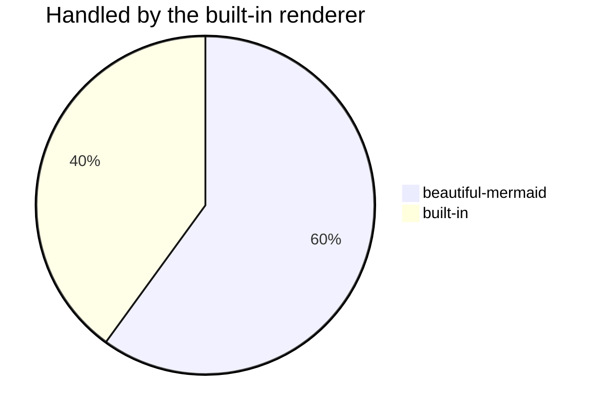
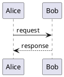
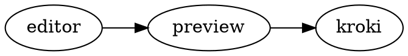

# Preview sample

[TOC]

## Tasks

- [x] Render diagrams
- [ ] Write the release notes
    - [ ] Nested follow-up

## GitHub syntax

> [!NOTE]
> Useful information that users should know.

> [!TIP]
> Helpful advice for doing things better.

> [!IMPORTANT]
> Key information users need to know.

> [!WARNING]
> Urgent info that needs immediate attention.

> [!CAUTION]
> Advises about risks or negative outcomes.

Footnotes work too[^1], and so do emoji :rocket: :tada:.

[^1]: Rendered by markdown-it-footnote.

## Mermaid







## Kroki





```d2
markdown -> kroki: POST
kroki -> preview: SVG
```

```svgbob
+-------+   +--------+
| Edit  |-->| Render |
+-------+   +--------+
```

## Optional syntax

These render only after you turn the `markdownToolkit.syntax.*` settings on: ==highlighted text== and E = mc^2^.

::: tip
VitePress-style tip container.
:::

::: warning Custom title
A warning with its own title.
:::

::: details Click to expand
Hidden until opened.
:::

## Math

Inline $e^{i\pi} + 1 = 0$ and a block:

```math
\int_0^1 x^2 \, dx = \frac{1}{3}
```
